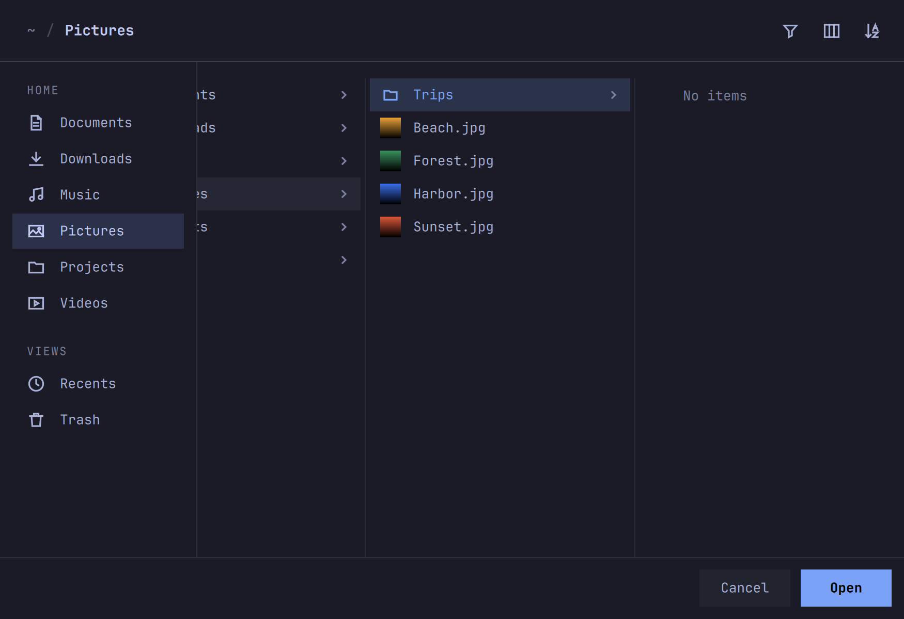
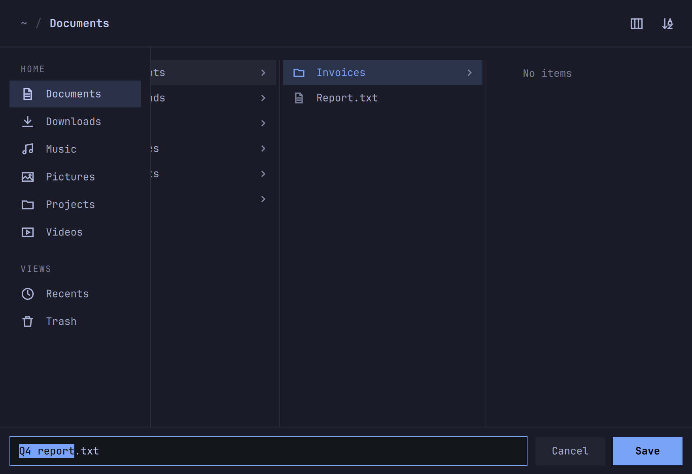

# Files


Files (`folio`) is Omarchy's file manager. It's one quiet window that follows your Omarchy theme and language, works from the keyboard, and never crawls your home folder in the background: folders are read when you open them, and thumbnails are made when a tile needs one, shared with every other app through `~/.cache/thumbnails`.

- **Three views**: Finder-style columns, a list that opens folders in place as a tree, and a grid with real previews. Ctrl+1/2/3 switches.
- **Space previews** pictures, video, audio, PDFs, text and Markdown at full size, in their own window.
- **The sidebar** holds everything in your home folder, pinned folders (shared with GTK file dialogs), Recents, Trash with restore, your drives (mounted or not, as Nautilus lists them: a click mounts one, and a drive plugged in mounts by itself), and the machines on your tailnet, which open over SFTP.
- **Right-click** (or Alt+Enter) to open with another app, rename, duplicate, compress, share by Dropbox link, Taildrop or LocalSend, and delete. Copy and paste work with other apps, and nothing is ever overwritten.
- **Split** the window in two with Ctrl+Alt+N to move things between folders.
- **Plugins** add sidebar sections, Share entries and views; Tailscale, Dropbox and LocalSend are plugins too. [docs/plugins.md](docs/plugins.md) shows how to write one.

| Columns | Preview |
| --- | --- |
|  |  |

## Keys

| Key | Does |
| --- | --- |
| Arrows, ⏎ | Move, open |
| Space | Preview |
| Backspace, Alt+← / Alt+→ | Up, back, forward |
| Ctrl+L | Type a path |
| / | Search here and below |
| Ctrl+C / X / V | Copy, cut, paste |
| F2, Delete | Rename, move to the trash |
| Ctrl+Shift+N | New folder |
| Ctrl+P | Pin the folder |
| Ctrl+N, Ctrl+Alt+N | New window, split |
| Tab, Shift+Tab | Sidebar, panes and details |
| ? | Every other shortcut |

## Open and save dialogs

Files can also be the Open and Save dialog in other apps. `folio chooser` is a file chooser for xdg-desktop-portal, which apps like Firefox, Chromium and every Flatpak ask for their dialogs. To use it, put this in `~/.config/xdg-desktop-portal/hyprland-portals.conf`:

```ini
[preferred]
default=hyprland;gtk
org.freedesktop.impl.portal.FileChooser=folio
```

Then `systemctl --user restart xdg-desktop-portal`. A dialog is then a Files window, with a bar along the bottom for the name to save under, Cancel and the button that answers. When the app offers a choice of filters (Images, All files), they're under the funnel beside the view buttons, or Ctrl+F. ⏎ on a file or a double click picks it, Ctrl+⏎ answers from anywhere, and Escape or closing the window cancels.

Its windows have their own app id, `folio-chooser`, and open at 875×600, the size Omarchy gives its floating windows. To float and center them the way Omarchy does GTK's dialogs, add this to `~/.config/hypr/hyprland.lua`:

```lua
o.window("folio-chooser", { tag = "+floating-window" })
```

| Open | Save |
| --- | --- |
|  |  |

Two things it leaves out. Some apps add their own choices to a dialog (an encoding, say); those aren't shown, and the app keeps its defaults. And the dialog isn't attached to the app's window: it opens as a window of its own, not over the app.


Files is C++ and Qt Quick. `bin/build` compiles it into `build/folio`, and `bin/test` runs the tests. Omarchy installs it from [omarchy-pkgs](https://github.com/omacom/omarchy-pkgs).

## License

Files is released under the [MIT License](LICENSE).
